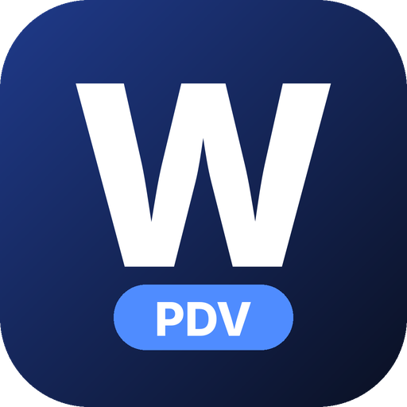

# O caixa da sua casa, mesmo quando a internet cai

Dois programas para quem vende bebida e comida no balcão: **WillPDV**, para bar, boate, casa noturna e evento, e **Will Adega**, para adega e distribuidora. A venda fica no computador da loja. O dono acompanha pelo celular.

## As duas edições

### WillPDV — bar, boate, casa noturna e evento

Feito para o salão. Mesa, comanda, garçom, comissão, quartos e o porteiro no celular. O cardápio por QR é só para o cliente olhar o preço. **A boate não recebe pedido online.**

### Will Adega — adega e distribuidora de bebidas

Feito para quem compra e revende bebida. Cardápio por QR com pedido online, preço de custo e lucro, nota de compra importada do XML e relatórios de margem. Sem mesa, sem comissão de casa noturna e sem porteiro.

## O que você ganha

- ⚡ **Caixa rápido.** O operador lança o produto, recebe e fecha. O movimento do dia não depende de um site. Se a casa tiver logotipo, ele aparece no topo da tela.
- 📄 **Cupom mais curto.** O cupom e o fechamento podem sair com menos linhas, para gastar menos papel. Dá para desligar.
- 📦 **Estoque.** Cada venda baixa o saldo. Dá para ver o que acabou, o que está no mínimo e montar a lista de compra.
- 📱 **Painel do dono no celular.** Faturamento de onde você estiver. Dá para marcar uma meta do mês e esconder os valores na tela daquele aparelho. Na adega, a aba Relatórios mostra custo, lucro e margem do período, o que mais deu lucro, estoque a custo e a preço de venda, e as notas de compra.
- 🚪 **Porteiro no celular (WillPDV).** Quem está na porta consulta a comanda sem ir até o caixa.
- 🧾 **Cardápio por QR.** O cliente aponta a câmera e vê o cardápio. Na Will Adega, esse cardápio também vira pedido. Na boate, é só consulta.
- 🛵 **Pedidos online, só na Will Adega.** O pedido chega no caixa para a equipe aceitar. A edição de boate não tem esse botão.
- 📥 **Nota de compra com lucro previsto (Will Adega).** O gerente importa o XML da nota do fornecedor (ou um ZIP com várias). Antes de lançar, confere o produto, o fardo e o custo. A tela mostra quanto a mercadoria deve render e quanto já rendeu.
- 📊 **Relatórios em PDF e CSV.** No computador, o gerente filtra o período e exporta. Abre no Excel ou imprime.
- 🔄 **Atualização do programa.** Quando sai uma versão nova, o caixa pode baixar e instalar sozinho, com o movimento parado, sem formatar o computador.
- 🔌 **Funciona sem internet.** A venda grava no computador da loja. Quando a rede volta, o caixa conversa com a nuvem (licença, painel e pedidos da adega).
- 🏪 **Cada casa no seu caixa.** Um ponto de venda por loja. Se você tem mais de uma, cada uma opera sozinha e o dono abre o painel daquela casa.
- 🔒 **Quem vê o custo.** O operador de caixa não vê preço de custo nem lucro. Isso fica com o gerente.
- 💬 **Resumo no WhatsApp.** No fechamento, o sistema monta o resumo do dia e abre o WhatsApp para você enviar. Não é um robô: quem manda a mensagem é o seu celular.

## WillPDV e Will Adega

| | WillPDV | Will Adega |
| --- | --- | --- |
| Bar, boate, evento | Sim | Não é o foco |
| Adega e distribuidora | Não é o foco | Sim |
| Mesa, comanda e garçom | Sim | Não |
| Porteiro no celular | Sim | Não |
| Comissão e quartos | Sim | Não |
| Cardápio por QR | Consulta | Consulta e pedido |
| Pedido online | Não | Sim |
| Custo, lucro e nota fiscal de compra (XML) | O gerente pode usar | Sim, é o centro da edição |
| Painel no celular | Sim | Sim, com a aba Relatórios |
| Venda sem internet | Sim | Sim |

## Como funciona

1. **Instalação.** O programa entra no computador da loja. Na primeira entrada, uma lista mostra o que falta: licença, dados da casa, impressora, produtos, nuvem e cópia de segurança. No WillPDV você escolhe o tipo de negócio. Na Will Adega esse tipo já vem certo.
2. **Cadastro.** Você coloca os produtos, os preços e quem pode operar. Na adega, dá para trazer a planilha ou a nota do fornecedor em XML.
3. **Vender.** A equipe atende. O estoque acompanha. Você olha o resultado no celular.

## Fale conosco

Quer ver o caixa na sua casa? Chame no WhatsApp.

**WhatsApp:** (XX) XXXXX-XXXX

> Troque este número pelo contato comercial antes de publicar a página. Ele está de propósito em branco.

**Mensalidade:** a combinar. O valor não está nesta página.

A licença é mensal. Sem ela, o caixa avisa e, depois da carência, pede a renovação.

## Para quem mexe no programa

O guia de instalação, testes, licença e nuvem ficou em [docs/DESENVOLVIMENTO.md](docs/DESENVOLVIMENTO.md).

Licença do código: proprietária, código visível. Veja [`LICENSE`](LICENSE).
